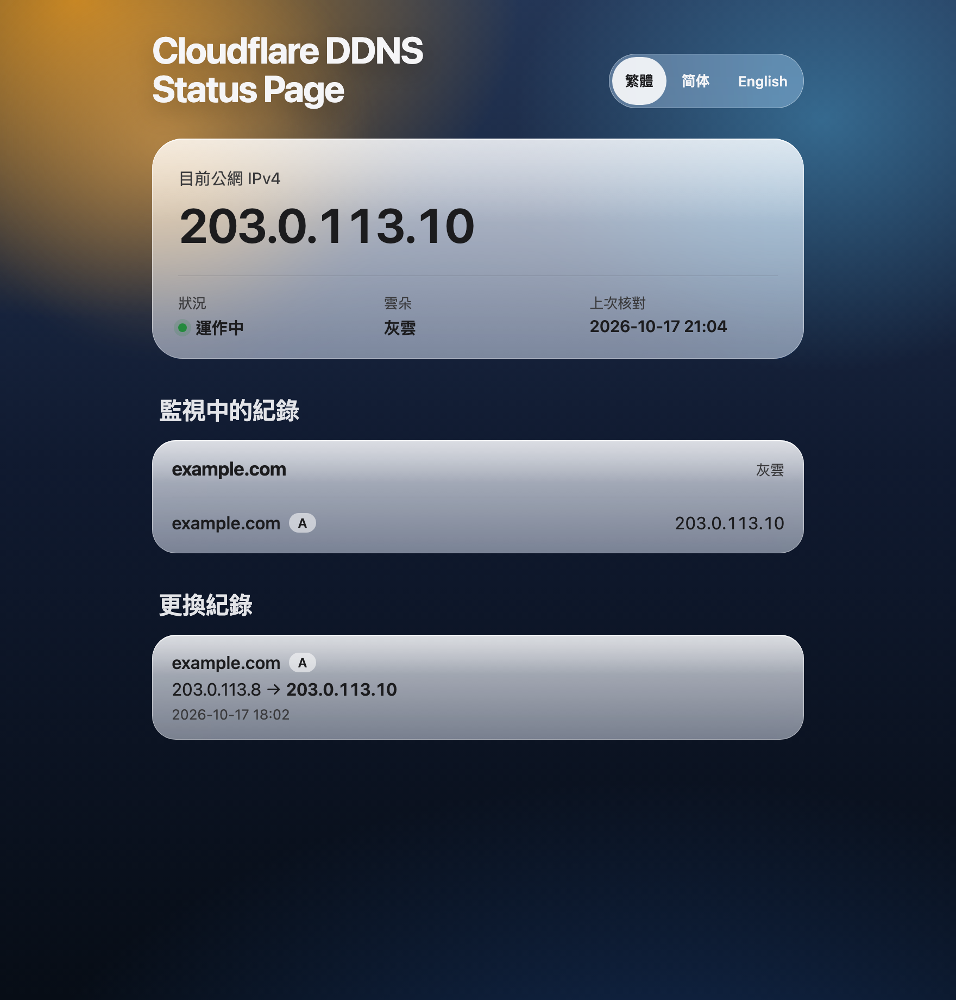
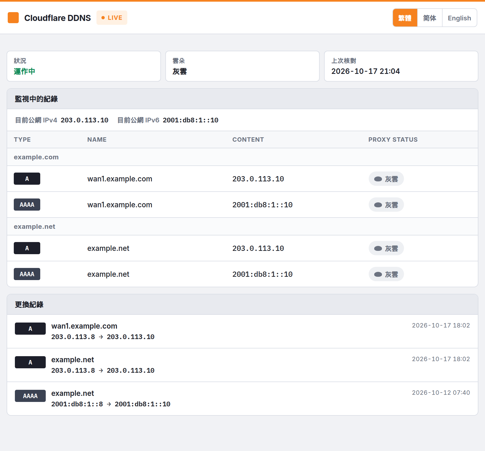
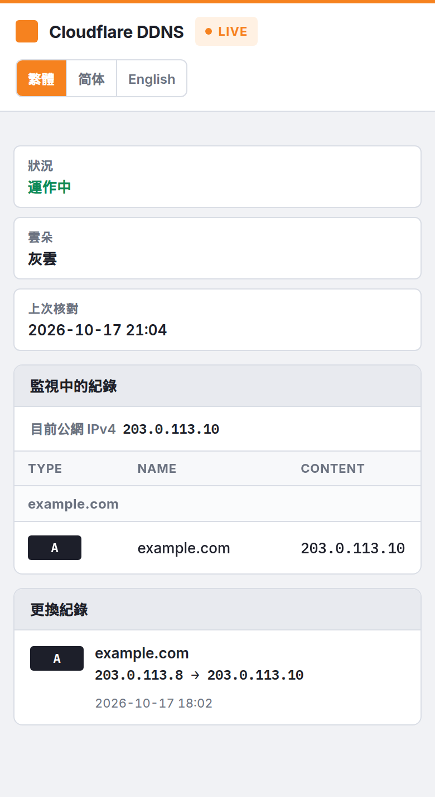

# cloudflare-ddns

Keep Cloudflare A and AAAA records pointed at this host's public address, and send a notice when that address changes.

[English](./README.md) | [繁體中文](./README.zh-TW.md)

[](https://github.com/wongkino/cloudflare-ddns/releases)
[](./LICENSE)
[](https://github.com/wongkino/cloudflare-ddns/stargazers)

The container follows the host's default route. After the gateway changes, the next check publishes the new address to every selected record.

## ✨ Features

- Publish this host's public IPv4, IPv6, or both, according to `RECORD_TYPES`.
- Update one zone, or only the zones you list. Other zones in the account stay untouched.
- Send one [Apprise](https://github.com/caronc/apprise) notice when an address itself changes. TTL-only edits stay quiet.
- Skip Cloudflare while the address matches the last check, and still recheck on a timer so hand edits are put back.
- Open an optional status page for the current address, the watched names, real changes, and the image version.
- Dry-run a round and print the writes without calling Cloudflare's write API.

## 🖼 Preview

The pictures use sample data (`example.com`, `203.0.113.10`). They are not a deployment.

The page is a light DNS console: an orange signal strip, status tiles, then a table of Type, Name, Content, and Proxy status.



- The orange strip and the LIVE chip mean the updater is running. The image version sits beside that chip.
- Three tiles show status, grey cloud or orange cloud, and the last check.
- The address line is the current public address. This picture watches A only, so it shows IPv4.
- Watched records are a DNS table. A grey-cloud pill means DNS-only, and an orange-cloud pill means proxied.
- A change appears only when an address itself changes. The old address is on the left of the arrow.

### Specific zones



The same public address is written to every listed name. A and AAAA are separate rows. Each zone is a header in the table. The change list mixes updates from all of those names.

### Phone



On a narrow screen the status tiles stack, and the DNS table can scroll sideways. The control switches Traditional Chinese, Simplified Chinese, and English.

To look at the layout on this machine without calling Cloudflare:

```bash
python3 -m web.dev_server
```

That preview uses a single-zone sample.

## 🚀 Quick Start

### Installation

The host needs Docker, and its default route must be the path you want to publish. The compose files set `network_mode: host` so the container sees this machine's public IPv4 and IPv6. Do not add `ports`. When IPv6 cannot be read, AAAA records stay unchanged.

```bash
git clone https://github.com/wongkino/cloudflare-ddns.git
cd cloudflare-ddns
```

The image is `ghcr.io/wongkino/cloudflare-ddns:amd64`, and it is pulled again on each start. Put the token in the compose file you start. Do not commit that file after the token is filled in.

If the image is not public, log in with a GitHub token that has `read:packages`:

```bash
echo "$GITHUB_TOKEN" | docker login ghcr.io -u wongkino --password-stdin
```

The token needs Zone / DNS / Edit on the zones you list. Without `CLOUDFLARE_ZONE_ID`, it also needs Zone / Zone / Read.

### Usage

Edit `environment` in one compose file. One container shows one setup.

#### One zone

Use `docker-compose.yml`. On a 64-bit Raspberry Pi, use `docker-compose.arm64.yml`. That file already uses `ghcr.io/wongkino/cloudflare-ddns:arm64`.

`@` is that zone's apex. A fully qualified name in the zone, such as `wan1.example.com`, works too. An empty `A_RECORDS` updates the apex.

```yaml
DOMAIN: example.com
A_RECORDS: "@"
```

```bash
docker compose up -d
docker compose logs -f
```

On a 64-bit Raspberry Pi:

```bash
docker compose -f docker-compose.arm64.yml up -d
docker compose -f docker-compose.arm64.yml logs -f
```

#### Specific zones

Use `docker-compose.multi.yml`. Only the zones listed in `DOMAIN` are updated. On a 64-bit Raspberry Pi, change that file's `image` to `ghcr.io/wongkino/cloudflare-ddns:arm64`.

Every listed zone needs at least one fully qualified name. `wan1.example.com` updates only `example.com`. `example.net` updates that zone's apex. Do not use `@` or a name without a dot, such as `nas`. Those apply to every listed zone. When `CLOUDFLARE_ZONE_ID` is set, its order and count must match `DOMAIN`. Leave it empty to look zones up by name. Every selected name receives the same current public address. This program does not read individual router interfaces.

```yaml
DOMAIN: example.com,example.net
A_RECORDS: wan1.example.com,example.net
```

```bash
docker compose -f docker-compose.multi.yml up -d
docker compose -f docker-compose.multi.yml logs -f
```

#### Status page

`WEB_UI` is off by default. Set it to `true` and the same process serves the page on the host network at `WEB_PORT` (8080 by default). Do not add `ports`. The port stays closed while `WEB_UI` is `false`. Open `http://127.0.0.1:8080`.

The page shows that container's `DOMAIN`. There is no switch between setups. History is stored only when an address actually changes, up to 100 entries. A dry run does not store history. The version beside the LIVE chip is the one baked into the running image. `/api/status` includes it as `version`.

#### Dry run

Set `DRY_RUN` to `"true"` in the compose file you are using, then restart with that same file. The log lists records that would be created, updated, or deleted, and the notification text that would be sent. It does not call Cloudflare's write API. Set it back to `"false"` and run `up -d` again when the output looks right.

#### Common commands

One zone:

```bash
docker compose logs -f
docker compose restart
docker compose down
```

One zone on a 64-bit Raspberry Pi:

```bash
docker compose -f docker-compose.arm64.yml logs -f
docker compose -f docker-compose.arm64.yml restart
docker compose -f docker-compose.arm64.yml down
```

Specific zones:

```bash
docker compose -f docker-compose.multi.yml logs -f
docker compose -f docker-compose.multi.yml restart
docker compose -f docker-compose.multi.yml down
```

The container name is `cloudflare-ddns`. On `SIGTERM` or `SIGINT`, the process stops after the current round finishes.

## 📖 Documentation

### What each round does

1. Follow `RECORD_TYPES`. When it includes A, query IPv4 from `api4.ipify.org`, `ipv4.icanhazip.com`, and `v4.ident.me`. When it includes AAAA, query IPv6 from `api6.ipify.org`, `ipv6.icanhazip.com`, and `v6.ident.me`. A type that is not selected is not queried. If one source says the host is unreachable, the next source is tried. Lookup stops only when that address family has no route.
2. For IPv4, skip private, reserved, and `100.64.0.0/10` addresses. For IPv6, skip addresses that must not be published, including local, link-local, documentation, 6to4, and Teredo. If one selected family cannot be read, leave that family's records unchanged and still update the other. If every selected type fails, leave DNS unchanged for this round.
3. Set every name in `A_RECORDS` to the addresses found this round. Only the types selected in `RECORD_TYPES` are written. With `CF_PROXIED` false, records stay DNS-only. With it true, they are proxied by Cloudflare.
4. If the name is a CNAME, delete it and replace it with an address record. If several records of the same type exist, keep the one that already points at the target address and delete the rest. A and AAAA records do not replace each other.
5. Send Apprise only when an address itself changes. TTL-only edits and an unchanged address do not send a notice. A and AAAA changes in the same round go out as one notice.

While the addresses match the last successful check, the round skips Cloudflare. A full check still runs at least once every `RECHECK_SECONDS` (one hour by default), so records edited by hand are reverted within that interval. With `DRY_RUN` on, every round is a full check.

If the lookup or the Cloudflare API fails, existing records stay as they are.

### Configuration

Set these in the `environment` section of the compose file you start.

| Variable | Required | Default | Description |
| --- | --- | --- | --- |
| `CLOUDFLARE_API_TOKEN` | yes | | Cloudflare API token |
| `DOMAIN` | yes | | One domain, or comma-separated zones |
| `A_RECORDS` | no | apex | Names to update. `@` is only for one zone |
| `RECORD_TYPES` | no | `A,AAAA` | `A`, `AAAA`, or `A,AAAA` |
| `CLOUDFLARE_ZONE_ID` | no | lookup | Same order and count as `DOMAIN` |
| `INTERVAL_SECONDS` | no | `30` | Seconds between rounds. A positive integer |
| `RECHECK_SECONDS` | no | `3600` | Full Cloudflare check while the address is unchanged |
| `DNS_TTL` | no | `60` | TTL in seconds. Falls back to automatic TTL |
| `CF_PROXIED` | no | `false` | `true`, `1`, or `yes` enables the orange cloud |
| `DRY_RUN` | no | `false` | `true`, `1`, or `yes` logs changes without writing |
| `APPRISE_URLS` | no | empty | Notification URLs, separated by spaces |
| `WEB_UI` | no | `false` | `true` serves the status page |
| `WEB_PORT` | no | `8080` | Status page port. Closed while `WEB_UI` is false |

The health check expects a successful round within about 120 seconds. Keep `INTERVAL_SECONDS` under 90.

### Notifications

`APPRISE_URLS` takes [Apprise](https://github.com/caronc/apprise/wiki) URLs as-is, for example Gotify `gotifys://` or Discord `discord://`. This program does not rewrite those URLs.

```yaml
environment:
  APPRISE_URLS: gotifys://gotify.example.com/token
```

An Apprise API server address is converted:

```text
https://apprise.example.com/notify/token
```

becomes:

```text
apprises://apprise.example.com/token
```

Separate multiple destinations with spaces. Different services can be mixed. A URL Apprise does not recognize is skipped. The rest are still sent.

The notice is in English. The title is `IP changed`. The body starts with the public IPv4 and IPv6 found this round, then lists each changed record, its type, and the previous and new address. A new record is shown as `(new record)`.

### Images

Open **Actions**, choose **Build image**, and select **Run workflow**. The workflow runs only when started by hand. Choose `amd64` for a regular computer, or `arm64` for 64-bit Raspberry Pi OS (Pi 3, 4, 5, and Zero 2 W). 32-bit Raspberry Pi OS cannot run the `arm64` image.

```text
ghcr.io/wongkino/cloudflare-ddns:amd64
ghcr.io/wongkino/cloudflare-ddns:arm64
```

The same run also pushes a commit tag prefixed with the architecture, a version tag, and that architecture's latest tag. An `amd64` version looks like `1.1.3`. An `arm64` version looks like `1.1.3-arm64`. Latest tags are `latest` and `latest-arm64`. An empty **Version** increments that architecture's patch, or starts at `1.0.0`. Fill it in only to choose a version, for example `2.0.0`. Use `1.2`, `1.2.0`, `v1.2.0`, or the same form with a suffix such as `-rc1`.

That same version string is passed into the image build as `APP_VERSION`. The status page reads it from the running container, so after an upgrade the top bar shows the new version. A source checkout with no version set shows `dev`.

## 🧰 Tech Stack

- Python 3.14.8 on Alpine, non-root user `10001`
- Apprise 2.0.1
- Cloudflare API v4
- Docker with `network_mode: host`
- Status page as one HTML file, served by the same process

## 📁 Project Structure

```text
.
├── Dockerfile
├── LICENSE
├── README.md
├── README.zh-TW.md
├── updater.py
├── docker-compose.yml
├── docker-compose.arm64.yml
├── docker-compose.multi.yml
├── docs/
│   ├── status-multi.png
│   ├── status-phone.png
│   └── status-single.png
├── web/
│   ├── dev_server.py
│   ├── fixtures.py
│   ├── index.html
│   ├── server.py
│   ├── snapshot.py
│   └── version.py
└── .github/workflows/docker-amd64.yml
```

## 🤝 Contributing

Open an issue or a pull request on GitHub. Keep sample names on `example.com`. Do not commit a compose file that contains a token.

## 📄 License

[MIT](LICENSE). Copyright (c) 2026 Kino Wong.
